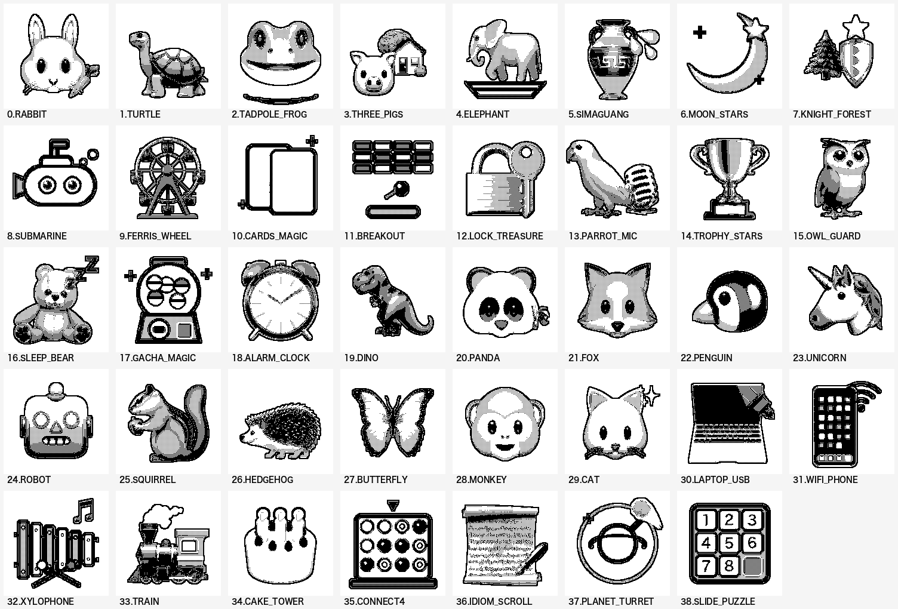

# 墨芽童伴 (InkSprout) — ESP32-S3-ePaper-3.97 儿童故事机与滚轮游戏掌机固件

专为微雪 **[Waveshare ESP32-S3-ePaper-3.97](https://docs.waveshare.net/ESP32-S3-ePaper-3.97/)** 硬件量身定制的护眼儿童故事机 + 三向拨轮益智游戏机固件（面向 **3–6 岁学龄前启蒙** 与 **6–12 岁学龄益智** 双龄段儿童）。

> 🎮 **无硬件在线真机交互模拟器（即点即玩）**：**[https://abc1234edawdfasdfewe.github.io/ink-sprout-epaper/](https://abc1234edawdfasdfewe.github.io/ink-sprout-epaper/)**  
> 📦 **免编译一键烧录固件下载**：见右侧 **[Releases](https://github.com/abc1234edawdfasdfewe/ink-sprout-epaper/releases)** 中的 `ink_sprout_kids_merged_0x00.bin`（烧录起始地址 `0x00`）。



---

## 1. 核心特性一览

- **零蓝光真护眼阅读**：驱动 3.97 英寸 `SSD1677` (`800 × 480`, 235 DPI) 电子墨水屏，支持 **~300ms 零黑闪局部刷新**、1.2s 快速清残影与全刷自愈防残影引擎。
- **全量汉字内嵌 Flash（免字库卡）**：内嵌完整 Unicode 常用汉字区（`20,902` 汉字 `16px/24px` + 标题 `32px` + 拼音声调与全角标点），无论内置绘本还是家长拷入 TF 卡的任意 UTF-8 `.txt` 故事书均零乱码、零寻道延迟。
- **原生滚轮交互（单手盲操）**：
  - **滚轮上/左拨 (`GPIO 4`) & 下/右拨 (`GPIO 6`)**：按下即响应 + 长拨平滑连滚（无双击等待迟滞）。
  - **滚轮中按 (`GPIO 5`)**：确认 / 翻牌 / 发射声呐泡泡 / 弹球发球 / 暂停伴读；**长按 0.75s** 等效返回（装入全包 3D 外壳不露侧键也能 100% 闭环操作）。
  - **侧边 `BOOT` 键 (`GPIO 0`)**：一键返回上一级。
  - **六轴摇一摇 (`QMI8658`)**：主界面或故事屋轻摇机身触发「随机盲盒听故事」。
- **双龄绘本故事屋 + TF 卡有声伴读**：
  - 内置 **7 册经典双龄插画绘本 + 读后智慧问答**（《小兔子乖乖》《龟兔赛跑》《小蝌蚪找妈妈》《三只小猪盖房子》《曹冲称象》《司马光砸缸》《为什么月亮会变弯？》）及 **1 部滚轮分支互动游戏书**《森林勇者奇遇记》。
- **绘本阅读页「滚轮生字拼音 · 华文楷体田字格放大 · 离线真人普通话点读」**：
  - **全场景阅读页一键唤起 (`app_word_study.c`)**：无论在内置经典绘本、外置 USB/热点导入的 `.txt` 绘本，还是 AI 扭蛋生成的专属故事页，**按下滚轮中键**即刻进入左文右卡「逐字点读放大镜」模式！
  - **教材级四线三格 + 104px 原生华文楷体田字格 (`hanzi_study_pack.bin`)**：内置全量 `20,902` 汉字拼音索引 + 语境多音字智能消歧词库（如自动区分《小兔子乖乖》中 `长耳朵 cháng` 与《小蝌蚪找妈妈》中 `长出后腿 zhǎng`）、共享基线的 **标准四线三格大号拼音**，以及 `3,769` 个一级常用字 **`104×104` 原生华文楷体 (`Kaiti SC`) 田字格**！
  - **100% 离线真人普通话单字与连词发音**：机内 Flash 预置 `1,388` 个普通话带调音节真人语音库（`16kHz Opus` 编码，零联网零延迟）——拨动滚轮移至任意汉字即刻朗读单字；**再按滚轮连读「单字 + 文中双字词组」**（如“兔 —— 白兔”），并自动收入 **「★ 我的生字卡片盒」**（支持田字格复习与 **摇一摇「听音找字」小闯关**）！
- **家庭路由器 Wi-Fi 按需联网 + 大模型 / 小智 AI「滚轮三步扭蛋生成专属睡前故事 + 语音同步自动翻页」**：
  - **24 × 24 × 24（13,824 种组合）滚轮三步扭蛋 (`app_ai_story.c`)**：第一圈转出 **24 位故事主角**（均配专属版画插画），第二圈转出 **24 个奇幻场景**，第三圈转出 **24 个成长主题**；亦支持 **六轴摇一摇机身** 一键摇出惊喜三合一扭蛋！
  - **朗读进度同步自动翻页**：小智 AI 模式实时记录每一句 `tts.sentence_start` 的精确 PCM 字节偏移，云端 TTS 与本地有声书按字数及标点停顿权重自动计算翻页路标，在页末换气停顿处自动触发 `~300ms` 无闪局刷翻页；中途拨动滚轮可随时切回手动翻阅。
  - **双模云端引擎 + 离线兜底**：
    1. **小智 AI 免 Key 语音故事模式（默认推荐）**：支持小智标准 OTA 协议（屏幕直接弹出 **6 位数字验证码** 供家长在 `xiaozhi.me` 绑定，终身免填 API Key），通过 `WSS` + 内置 `esp-opus` 同步接收 **故事文本 + 真人级 Opus 语音流**，实时解码保存为本机 `.txt` 与 `16kHz/24kHz .wav` 有声绘本！
    2. **通用大模型 + 云端 TTS 直连模式**：内置一键预设 **DeepSeek / 阿里云百炼通义千问 / 火山引擎豆包 / 硅基流动 SiliconFlow / 本地局域网 Ollama**，自动按 `3-6岁` 或 `6-12岁` 分龄控制词汇，把宝贝昵称融入故事并生成一道读后三选一问答；同时支持可选 `/v1/audio/speech`（如硅基流动 `CosyVoice2` / OpenAI TTS）合成同步 `.wav` 伴读！
    3. **本机离线奇幻组合兜底**：未连 Wi-Fi 或外出乘高铁/露营时，仍可用离线扭蛋引擎秒级生成专属睡前故事与问答。
  - **零辐射超低功耗策略**：仅在点击生成故事的十余秒内唤醒家庭路由器 Wi-Fi，绘本与音频落盘后**立即自动关闭 Wi-Fi 射频 (`esp_wifi_stop()`)**，孩子捧机阅读与听故事全程零辐射、不费电，且所有 AI 故事永久保存在书架可随时离线重听！
- **双通道传故事与一站式扫码配网工坊（USB 电脑免驱优盘 + `APSTA` 手机扫码配网/传书）**：
  - **免插卡双介质自适应**：插了 MicroSD 卡时优先读写 TF 卡 `/sdcard/stories`；未插 TF 卡时自动挂载机内 **3.8 MB 磨损均衡闪存盘 (`/flash/stories`)**，不买 TF 卡也能立刻用 USB 优盘和手机热点传故事！
  - **方式 A · USB 电脑优盘模式 (`TinyUSB MSC`)**：进入机内「传书工坊 -> USB电脑优盘传故事」，插上 Type-C 数据线即在 Mac Finder / Windows 资源管理器弹出 **`INKSPROUT`** 优盘，直接把 `.txt` 或 `.wav` 拖进 `stories` 文件夹即可！附带桌面脚本 `tools/send_story.py` 支持一键调用 macOS 中文语音合成同步 `.wav` 伴读。
  - **方式 B · 设备热点无线传书 (`SoftAP + Captive Portal + 双二维码`)**：进入「设备热点扫码传故事」，墨水屏直接显示两枚高清二维码——第一步扫码连免密热点 `InkSprout-Kids`，第二步自动弹出（或访问 `http://192.168.4.1`）离线网页工作台：支持 **在线粘贴/写故事秒传**、**自动将手机 MP3/M4A/WAV 转码为标准 16kHz 护耳单声道 WAV 上传**、**自动将 GBK 文本转 UTF-8 防乱码**，以及 **爸爸妈妈手机麦克风亲情录故事上传**！
- **14 款专为「三向滚轮 + 0.3s 局刷墨水屏」设计的双龄游戏**：
  - **启蒙游乐园（3–6 岁 · 6 款）**：
    1. **滚轮配配乐 · 摩天轮**：旋转立式摩天轮配对动物习性、数数与古诗，零挫败感正向激励。
    2. **海底小潜艇 · 接星星**：三航道节拍步进，拨轮上浮/下潜，中按发射声呐泡泡把水母变星星。
    3. **森林八音盒 · 滚轮小琴师**：拨轮滑过 8 根木琴键实时刮奏真马林巴音阶，跟弹《小星星》《两只老虎》《小兔子乖乖》《粉刷匠》。
    4. **小刺猬接果 · 丰收果园**：5 棵果树离散横移接红果，中按鼓起小刺将带刺毛栗变成奖励星星。
    5. **规律小火车 · 动脑装车厢**：纯图形动物排列规律（`ABAB` / `AAB` / `ABB` / `ABC`），3 岁不识字也能独立推理挂车。
    6. **熊猫叠蛋糕 · 甜蜜高塔**：拨轮微调吊臂对准托盘虚线中心放下奶油蛋糕，叠满 8 层点亮生日蜡烛。
  - **益智挑战营（6–12 岁 · 8 款）**：
    7. **数字摩天轮 · 算术高塔**：含「20 以内幼小衔接」与「乘除推理进阶」双档，拨轮转数字盘闯关。
    8. **翻转记忆牌 · 脑力配对**：3×4 版画动物卡牌环形滚轮寻址，锻炼瞬时空间记忆。
    9. **滚轮弹球台 · 经典打砖块**：一维旋钮挡板神作，支持长拨大步横移与物理角度反弹。
    10. **森林密码锁 · 逻辑破译**：滚轮模拟三位密码转轮（Mastermind 少儿版），附推理记录本。
    11. **四子连珠棋 · 智斗猫头鹰**：7 列重力四子棋，天生只需「选列 + 落子」，内置小狐狸学徒与猫头鹰大师防双杀 AI。
    12. **成语接龙轮 · 国学摩天轮**：6 字拼音转轮补全小学生经典成语，答对即调用内置真人语音库播报标准读音。
    13. **环轨防卫战 · 360°激光炮**：12 钟点圆周旋转空间站激光炮击碎来袭陨石。
    14. **数字华容道 · 智能滑块阵**：含 `3×3 八数码` 与 `4×4 十五数码`，滚轮自动锁定空格四周可移动的 2~4 块数字并标出滑入箭头。
- **全系统 39 款绘本版画风精致插画 + 双铃小闹钟待机画报**：加粗外轮廓 + 三阶有序网点版画工艺原生渲染 `64/96/176px` 三档图库，桌面 0mW 睡眠待机呈现「晚安小熊画框 + 双铃小闹钟 + `68px` 超粗体数字时钟」。
- **零依赖单文件网页真机模拟器 (`simulator/index.html`)**：无需实体开发板，双击或通过 GitHub Pages 打开即可在浏览器中交互体验 `800×480` 墨水屏、三向滚轮、有声绘本自动翻页、田字格生字点读、AI 扭蛋机与全部 14 款滚轮游戏。
- **变声小鹦鹉（麦克风 + 8MB PSRAM）**：板载麦克风最长录制 8 秒讲故事/背古诗，拨轮一键切换 **原声 / 花栗鼠搞怪快声 / 大狗熊憨憨慢声** 回放；附可滚动翻阅全部 14 款游戏最高分的 **星星荣誉墙**。
- **家长护航站**：护眼防沉迷番茄钟（15/20/30 分钟远眺提醒）、儿童听力保护最大音量锁（默认 80%）、0°/180° 握持与滚轮联动翻转、桌面 0mW 睡眠温湿度座钟（`SHTC3` + `PCF85063`）与安全关机（`TG28` 软断电）。

---

## 2. 板载硬件引脚映射（已对照官方原理图核实）

| 模块 | 芯片 / 器件 | ESP32-S3 引脚 | 备注 |
| :--- | :--- | :--- | :--- |
| 电源管理 | `TG28` (`AXP2101` 兼容, `0x34`) | `SDA=41, SCL=42, IRQ=38` | `ALDO3=3.3V` 供墨水屏，`ALDO1/2=3.3V` 供音频 |
| 3.97" 墨水屏 | `SSD1677` (`800×480`) | `SCLK=11, MOSI=12, CS=10, DC=9, RST=46, BUSY=3` | SPI3 DMA 20MHz |
| 三向拨轮 + 侧键 | 贴片三向定位拨盘 `U4` | `UP=4, OK=5, DOWN=6, BOOT=0` | 低电平有效，外部 10K 上拉 |
| 音频编解码与功放 | `ES8311` (`0x18`) + `NS4150B` | `MCLK=13, BCLK=14, WS=47, DOUT=48, DIN=21, PA=39` | 已修复官方例程 `QMI8658` 抢占 `GPIO39` 导致静音的隐患 |
| 实时时钟 / 温湿度 / 六轴 | `PCF85063` / `SHTC3` / `QMI8658A` | 共享 `I2C0 (41/42)`，`IMU_INT2=40` | 地址 `0x51` / `0x70` / `0x6A` |
| MicroSD 卡槽 | 4-bit SDMMC (`TF1`) | `CLK=16, CMD=17, D0=15, D1=7, D2=8, D3=18` | 挂载于 `/sdcard`，开启 UTF-8 长文件名 |

---

## 3. 编译与烧录指南

### 方式一：直接烧录已编译合并好的单文件固件（最快捷）

项目编译产物已生成单文件合并固件 `build/ink_sprout_kids_merged_0x00.bin`（烧录起始地址 **`0x00`**）：

1. 用 Type-C 数据线将 `ESP32-S3-ePaper-3.97` 连接至电脑（若未识别串口，按住侧边 **`BOOT`** 键再短按电源上电进入下载模式）。
2. **macOS / Linux 一键命令行烧录**：
   ```bash
   source ~/esp/esp-idf/export.sh
   esptool.py --chip esp32s3 --baud 921600 write_flash 0x0 build/ink_sprout_kids_merged_0x00.bin
   ```
3. **Windows 乐鑫官方 Flash Download Tool 烧录**：
   - ChipType 选择 `ESP32-S3`，WorkMode 选择 `Develop`，LoadMode 选择 `USB`。
   - 勾选 `build/ink_sprout_kids_merged_0x00.bin`，右侧地址填写 **`0x00`**，点击 `START`。

### 方式二：源码修改与重新编译（ESP-IDF v5.5+）

```bash
source ~/esp/esp-idf/export.sh
cd ink-sprout-epaper
idf.py build
idf.py -p /dev/cu.usbmodem* flash monitor
```

---

## 4. 电脑 USB 优盘传故事 & 手机热点无线传故事指南

进入机器 **「绘本故事屋 -> 10. 传书工坊」** 或 **「传书与家长 -> 1. 传书工坊」**：

### 通道一：USB 电脑优盘拖拽传书（免装任何软件）
1. 滚轮选择 **「USB 电脑优盘传故事」** 按下确认，将开发板 Type-C 口插入电脑。
2. 电脑自动弹出优盘（插了 TF 卡则显示整张 TF 卡；未插卡则显示内置 3.8MB 闪存盘），打开其中的 `stories` 文件夹，拖入 `.txt` 或 `16kHz 16-bit .wav` 文件。
3. **进阶自动配音命令**（macOS 终端一键将任意 `.txt` 生成真人中文语音伴读并拷入优盘）：
   ```bash
   python3 ./tools/send_story.py 你的故事.txt --tts
   ```
4. 在电脑弹出优盘后，按下故事机滚轮即可安全收回存储并同步书架。

### 通道二：设备 Wi-Fi 热点扫码无线传书（支持手机/平板/电脑）
1. 滚轮选择 **「设备热点扫码传故事」** 按下确认。
2. 用手机相机扫屏幕左侧二维码连接免密热点 **`InkSprout-Kids`**，手机会自动弹出传书网页（若未自动弹出，扫右侧二维码或浏览器打开 `http://192.168.4.1`）。
3. 在网页中可直接：**① 粘贴文字秒传 TXT**、**② 批量上传手机里的 TXT / MP3 / M4A / WAV（网页自动完成 GBK→UTF-8 转码与 16kHz WAV 音频重采样）**、**③ 点击麦克风录下爸爸妈妈讲故事的声音**，还能远程点击 `▶播放` 为孩子点播睡前故事！
